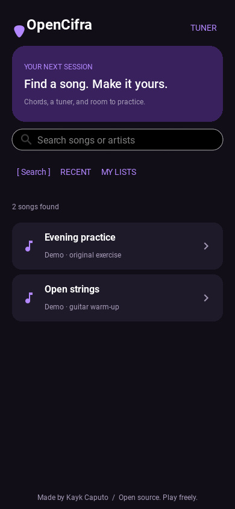
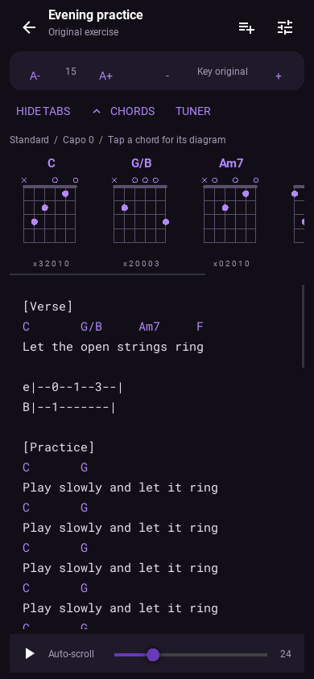
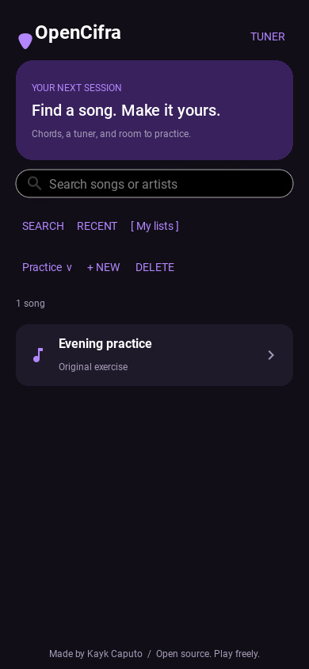
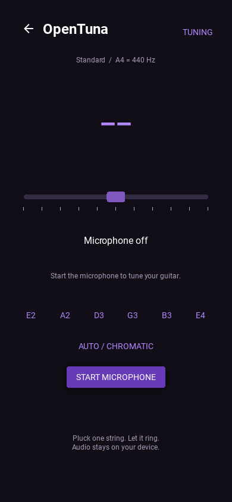

# OpenCifra

An open-source guitar songbook and practice companion for desktop and Android. Built with Python, Kivy and KivyMD, with an English interface and the original dark / Deep Purple palette.

## Screenshots

<p align="center">
  
  
</p>
<p align="center">
  
  
</p>

Captured from the running desktop app at a mobile-sized window, using an original practice exercise. The tuner screenshot shows the microphone off. Regenerate them with `make screenshots` (requires Xvfb on Linux).

## Practice tools

- Debounced song search, stale-response protection, recent songs and bounded in-memory caches.
- Named favorite lists, saved locally; create lists and add/remove songs from the playlist button.
- Adjustable font size, tablature visibility and automatic scrolling with a speed slider. Touching the sheet pauses scrolling.
- Semitone transposition and capo controls. Changing capo adjusts chord shapes to preserve sounding pitch; changing key changes pitch. Reset restores the original sounding key.
- Chord diagrams above the sheet, alternate positions on chord tap, and standard / Drop D / half-step down / DADGAD / Open G / Open D tunings.
- A local chord generator supplements `guitar.json`, including extensions, altered chords, Brazilian `7M` notation and slash bass notes. Calculations run off the UI thread and are cached. Omitted nonessential notes are labeled. Unrecognized symbols or shapes that cannot fit the supported six-string/four-finger search are explained rather than shown as an incorrect diagram.
- Integrated **OpenTuna**: chromatic tuning, individual string targets, cents meter and FFT-accelerated pitch detection. The microphone starts only when requested and stops when leaving the tuner or suspending the app.

Tuning selection changes chord fingerings and tuner targets; it does not retune an instrument or rewrite source tablature. Transposition applies to chord symbols, not tablature fret numbers. Diagrams show frets relative to the capo.

## Run locally

Python 3.10+ is required. On Linux, microphone capture requires PortAudio (for example, `sudo apt install libportaudio2`).

```sh
make install
make run
```

Without Make: create and activate a virtual environment, run `pip install -r requirements.txt`, then `python main.py`. KivyMD is pinned to 1.2.0 because the application uses its stable widget API. Desktop audio uses SoundDevice; Android uses AudioRecord through Pyjnius.

## Development

```sh
make dev          # runtime, Ruff and PyInstaller
make check        # lint and offline unit tests
make test-ui      # real Kivy UI smoke test; requires Xvfb on Linux
make doctor       # dependency and tool availability
make help         # all available targets
```

Tests cover parsing, markup escaping, tablature filtering, transposition, library persistence, network mocks, chord voicings across tunings and pitch accuracy with synthetic signals. UI smoke tests use an original practice exercise, temporary user data and no microphone or network access. Screenshots are written under `/tmp/opencifra-*.png`.

- `main.py`, `ui.kv`: interface, navigation and practice controls.
- `songbook.py`: remote requests, parsing, session caches and local library.
- `music.py`, `guitar.json`: chord formulas, tuning and generated/catalog voicings.
- `opentuna/`: adapted OpenTuna audio engine and pitch detector; original MIT license retained.
- `tests/`, `scripts/`: checks and packaging/release helpers.

Favorites contain titles and artists, not downloaded lyrics. Preferences and lists are saved atomically in Kivy's platform-specific user data directory (`~/.config/opencifra/library.json` on Linux). Song content is cached only for the running session. Search and song retrieval require internet access and depend on the source remaining available; rate limits, denied requests and network errors are displayed with retry controls.

## Build

```sh
make dev
make build-desktop       # native distribution in dist/OpenCifra/
make android-tools      # Python build tooling
make android-debug      # APK in bin/
make android-deploy     # install and run on an attached device
make android-logcat
make package            # desktop archive, Android artifacts and SHA256SUMS
```

Build desktop packages on each target OS; cross-compiling desktop binaries is not supported. Android builds require the [Buildozer system prerequisites](https://buildozer.readthedocs.io/en/latest/installation.html), Java, SDK and NDK; the first build downloads a substantial toolchain. Review package identity, version, target SDK and signing before distributing to an app store. `buildozer.spec` retains the existing application identity.

For a signed Android release, export `P4A_RELEASE_KEYSTORE`, `P4A_RELEASE_KEYSTORE_PASSWD`, `P4A_RELEASE_KEYALIAS` and `P4A_RELEASE_KEYALIAS_PASSWD`, then run `make android-release` for an APK or `make android-release ANDROID_ARTIFACT=aab` for an AAB. Store signing credentials outside the repository. See [python-for-android signing](https://python-for-android.readthedocs.io/en/latest/quickstart.html#release-mode).

### Android build troubleshooting

Use `make android-debug` / `make android-release` so the Android wrapper is applied. The project pins python-for-android and supplies a local KivyMD 1.2.0 recipe because that release is distributed as source, not an Android wheel. A second recipe installs the portable Python implementation of `charset_normalizer`, avoiding an Android binary wheel being passed to the host installer.

The KivyMD recipe explicitly copies its `.kv` layouts and other resources using relative paths. This fixes an upstream packaging bug triggered by repeated `kivymd/` components in Android build paths, which produced APKs that closed during startup. Cached distributions missing those layouts are backed up and rebuilt automatically, retaining the compiled native libraries. Every successful Android build now checks all 36 layouts in every ABI of the final APK/AAB. Run the same check manually with `make android-verify APK=bin/your-app.apk`.

The wrapper fixes pip at 25.3, matching the bundled Python 3.14.2 `ensurepip`. This avoids mixing pip versions when python-for-android recreates its shared build environment for the second ABI. If an older build left a mixed environment (`ImportError: cannot import name capture_logging`), the wrapper backs up only that environment and recreates it; compiled libraries and SDK/NDK caches are retained.

Use `BUILDOZER_LOG_LEVEL=2 make android-debug` for verbose output; the default shows progress without listing every compiled library. Build output is filtered to redact signing passwords and other secret environment values. Existing logs are not rewritten; do not share unfiltered Buildozer environment dumps. The compatibility constraint lives in `scripts/android-constraints.txt` and should be reviewed when updating the python-for-android commit.

## GitHub releases

Set the version in `buildozer.spec`, commit changes, build the desired artifacts, and run `make package`. Use an empty release asset directory for each version (`ASSETS=dist/release-VERSION`) to avoid including older builds. Authenticate with `gh auth login` and create/push the version tag:

```sh
git tag -a v0.3.1 -m 'OpenCifra 0.3.1'
git push origin v0.3.1
make release-check TAG=v0.3.1
make release-draft TAG=v0.3.1
# Review the draft, artifacts and generated release notes on GitHub.
make release-publish TAG=v0.3.1
```

`REPO=owner/repository` and `ASSETS=path` are configurable. Release checks require a clean tree, a version-matching tag at HEAD on the selected remote, and matching artifact checksums. Android assets must match the release version and pass the runtime resource check. Publication verifies the uploaded asset digests against the local files. Draft creation and publication are separate [GitHub CLI operations](https://cli.github.com/manual/gh_release_create). These targets upload/publish only when explicitly run. `make clean` removes `build/` and `dist/`, keeping the virtual environment, Android SDK cache and personal library.

## Attribution, privacy and licensing

Created by Kayk Caputo. OpenTuna is integrated from the sibling `open-tuna` project, also by Kayk Caputo; its license is in `opentuna/LICENSE.md`. Audio is processed locally and is never recorded to disk or uploaded. OpenCifra has no analytics or account system. Remote sources receive requests when users search or load songs.

Lyrics and musical works belong to their respective authors. OpenCifra retrieves and displays content at the user's request; it does not host or redistribute a lyrics catalog. Source attribution and credits are preserved. Copyright holders can contact the project through an issue.

The official repository is [KaykCaputo/OpenCifra](https://github.com/KaykCaputo/OpenCifra). Download binaries only from its official releases. Contributions and forks should retain the MIT license and original-project attribution. See [LICENSE](LICENSE). Software is provided as is.
